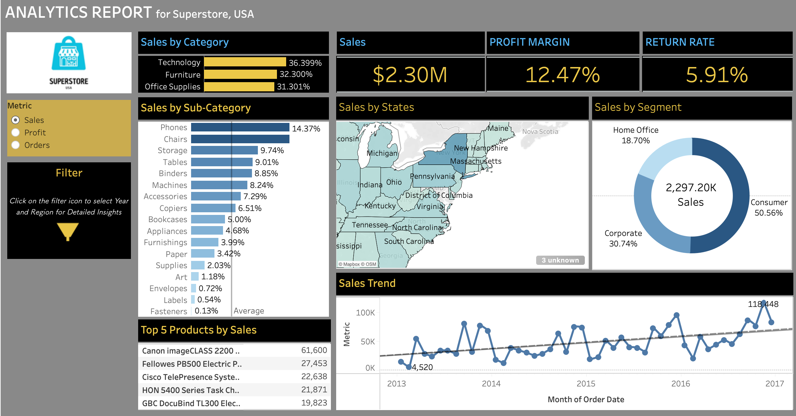
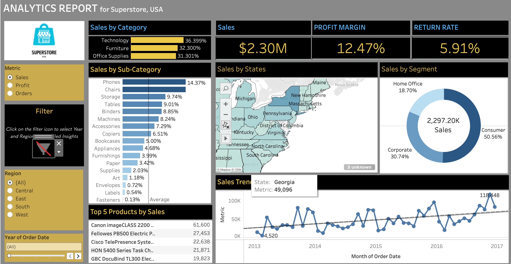

# Superstore Sales Dashboard (Tableau)

An interactive Tableau dashboard analysing sales, profit and orders for a US retailer (Superstore), 2013–2017.



## What the dashboard shows

- **KPI cards:** total sales, profit margin and return rate
- **Sales by category and sub-category:** share of total sales
- **Sales by state:** map of the US, shaded by the selected metric
- **Sales by segment:** Consumer, Corporate and Home Office
- **Sales trend:** monthly trend with a trend line, 2013–2017
- **Top 5 products by sales**
- **Controls:** a Metric selector (Sales, Profit, Orders) that switches the views, plus Region and Year filters



## Key numbers

| Metric | Result |
|---|---|
| Total sales | $2.30M |
| Profit margin | 12.47% |
| Return rate | 5.91% |

## Insights

- **Sales are spread evenly across categories:** Technology 36.4%, Furniture 32.3%, Office Supplies 31.3%.
- **Phones (14.4%) and Chairs are the largest sub-categories.** Fasteners, Labels and Envelopes each contribute less than 1%.
- **Consumers drive half of sales** (50.6%), followed by Corporate (30.7%) and Home Office (18.7%).
- **Sales trend upward from 2013 to 2017**, with strong month-to-month swings. The highest month is about 118K in 2017.
- **One product stands out:** the Canon imageCLASS 2200 leads with 61,600 in sales, more than double the second product (27,453).

## Notes

- Built with Tableau on the public Superstore sales dataset, not company data.
- The map shows "3 unknown" because Tableau could not match three locations to a state.

## Files

```
superstore-sales-tableau/
├── README.md
├── superstore-dashboard.png
└── superstore-dashboard-filters.png
```

## Author

Komal Joshi, Data Analyst, Hyderabad.
[LinkedIn](https://www.linkedin.com/in/komal-joshi-359139337/) · [Portfolio](https://komal-joshi.netlify.app/) · komaljoshi0728@gmail.com
